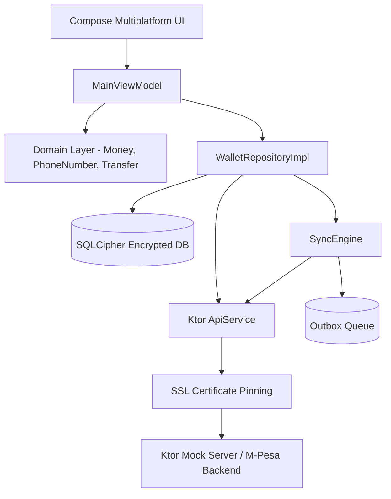

# Mobile Wallet 🇰🇪 📱

[](https://kotlinlang.org/docs/multiplatform.html)
[](https://www.jetbrains.com/lp/compose-multiplatform/)
[](https://www.zetetic.net/sqlcipher/)
[](https://ktor.io/)
[](LICENSE)

A **security-first, offline-resilient Mobile Wallet prototype** built using **Kotlin Multiplatform (KMP 2.0.21)** and **Compose Multiplatform UI**. Built for Kenyan mobile financial engineering workflows (Nairobi, Kenya), featuring Safaricom M-Pesa green design system styling, minor-unit KES currency precision, SQLCipher AES-256 encrypted storage, biometric authentication, SSL certificate pinning, root/jailbreak integrity signals, offline outbox synchronization with exponential backoff & jitter, Fastlane release pipelines, and a Ktor JVM mock backend server.

---

## 📸 Screen Showcase

| Home Screen & Services | Settings & Security | Transaction History |
| :---: | :---: | :---: |
|  |  |  |

---

## ⚡ Core Highlights & Architectural Features

### 1. 💰 Domain Layer & Financial Precision
- **Minor-Unit Arithmetic**: All balances and transfers are calculated in integer minor units (KES cents) using pure `Long` arithmetic to eliminate floating-point rounding errors.
- **Kenyan Mobile Phone Validation**: Strict regex parser for `+2547XXXXXXXX` and `+2541XXXXXXXX` formats, automatically normalizing local formats (`07...`, `01...`) to canonical E.164.
- **CBK Single Transaction Limits**: Built-in transfer validation for Central Bank of Kenya limits (Single transfer limit: KSh 150,000; Minimum transfer: KSh 10).

### 2. 🔐 Encrypted Database Storage (SQLCipher)
- **SQLDelight 2.0.2 Schema**: Platform-agnostic SQLite database (`AppDatabase.sq`) containing `accountEntity`, `transactionEntity`, and `outboxEntity`.
- **AES-256 Encryption at Rest**: Encrypted SQLCipher database drivers on Android (`AndroidSqliteDriver`) and iOS (`NativeSqliteDriver`).
- **Hardware Key Wrapping**: Master database encryption key randomly generated and wrapped using **AndroidKeyStore** (AES/GCM) and **iOS Keychain**.

### 3. 🔒 Security & Device Integrity Signals
- **Biometric Authentication**: Unified `BiometricAuthenticator` interfacing with `BiometricPrompt` (AndroidX) and `LAContext` (iOS).
- **Auto-Lock Manager**: Monotonic timer monitoring user inactivity to trigger automatic wallet locking after 60 seconds.
- **Multi-Signal Root & Jailbreak Detection**: Evaluates system paths for `su` binaries, `test-keys` build tags, Cydia / Sileo paths, `dyld` dynamic library injections, and sandbox write permissions.
- **SSL Certificate Pinning**: Custom Ktor client engine configurator evaluating SHA-256 public key hashes with backup rotation pins.

### 4. 🔄 Offline Outbox Queue & Backoff Engine (`SyncEngine`)
- **Idempotent Queueing**: Transactions created offline are saved locally to `outboxEntity` with a UUID `idempotencyKey`.
- **Resilient Retry Sync**: `SyncEngine` retries pending transfers using exponential backoff (`1000ms * 2^retry`) constrained between 1s and 30s with randomized jitter (`0.8x - 1.2x`).

### 5. 🎨 Safaricom Green Material 3 Design System
- **Kenyan Theme Palette**: Styled with Safaricom Green (`#00A859`), Deep Forest (`#006837`), and M-Pesa Red (`#E21B23`).
- **Interactive UI Components**: Balance privacy toggle (`👁️ Hide/Show`), Quick Services Grid (Send Money, Lipa na M-Pesa, Buy Airtime, Bank Transfer), and dynamic Light/Dark Mode theme switcher.

### 6. 🖥️ Ktor JVM Backend Server (`:server`)
- **RESTful Endpoints**: Full backend engine serving `/register`, `/login`, `/balance`, `/send`, and `/history`.
- **Strict Idempotency Caching**: Prevents duplicate charge execution on retried requests.
- **Chaos Failure Injection**: `/chaos` endpoint allowing developers to inject simulated network timeouts (`504 Gateway Timeout`), server crashes (`500 Internal Server Error`), or rate limits (`429 Too Many Requests`) to test client outbox resilience.

---

## 🏗️ Architecture Diagram



---

## 🛠️ Project Structure

```
mobile-wallet/
├── androidApp/          # Android App Entry Point (MainActivity, Manifest)
├── composeApp/          # Shared Compose Multiplatform UI Screens & Components
├── server/              # Ktor 3.0 JVM Mock Server with Chaos Failure Injection
├── shared/              # KMP Domain Logic, SQLCipher Storage, Network & Security
│   ├── commonMain/      # Shared Domain Models, SQLDelight DB Schema, Repositories
│   ├── androidMain/     # Android KeyStore, BiometricPrompt, Root Detection
│   └── iosMain/         # iOS Keychain, LAContext, Jailbreak Signals
├── fastlane/            # Fastlane Release Pipelines (Matchfile, Fastfile)
├── docs/                # Architecture, STRIDE Threat Model, ADRs & Screenshots
├── build.gradle.kts     # Root Build Configuration
└── settings.gradle.kts  # Module Registry
```

---

## 🚀 Running the Project

### Prerequisites
- JDK 17 or higher
- Android SDK 35 & Android Emulator / Physical Device
- macOS & Xcode (for iOS targets)

### 1. Build and Run the Android App
```bash
# Compile debug APK
./gradlew :androidApp:assembleDebug

# Install on connected device/emulator
adb install -r androidApp/build/outputs/apk/debug/androidApp-debug.apk
```

### 2. Run the Ktor Mock Server
```bash
# Launch server on port 8080
./gradlew :server:run
```

### 3. Run Unit Tests
```bash
# Execute unit test suite across server and shared modules
./gradlew :server:test :shared:testDebugUnitTest
```

---

## 🛡️ STRIDE Threat Model & Security Posture

| Threat Category | Risk Mitigation Implementation |
| :--- | :--- |
| **Spoofing** | Certificate Pinning with OkHttp & Darwin engines; SHA-256 pin verification. |
| **Tampering** | SQLCipher AES-256 encryption at rest; OS KeyStore / Keychain master key wrapping. |
| **Repudiation** | UUID Idempotency Key validation on both client outbox and server endpoints. |
| **Information Disclosure**| Balance mask privacy toggle (`👁️ Hide`); Auto-Lock timer after 60s inactivity. |
| **Denial of Service** | Exponential backoff retry engine with jitter to prevent server thundering herds. |
| **Elevation of Privilege**| `IntegrityChecker` detecting root/jailbreak su binaries, Cydia, and sandbox tampering. |

---

## 📄 License & Disclaimer

This project is licensed under the [MIT License](LICENSE).

> [!IMPORTANT]
> **Financial & Prototype Disclaimer**: This repository is a technical demonstration prototype designed to showcase Kotlin Multiplatform architecture, mobile security best practices, and offline outbox resilience. It does not process actual currency or interface directly with live Safaricom M-Pesa production systems.
